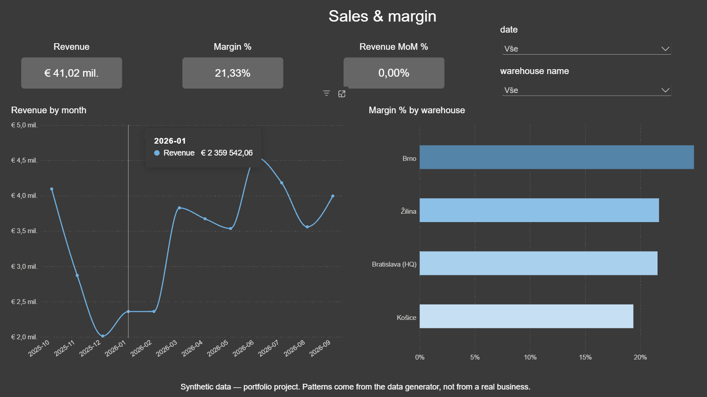
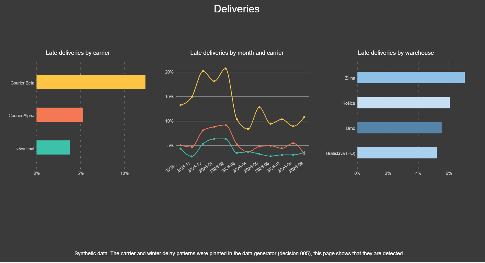
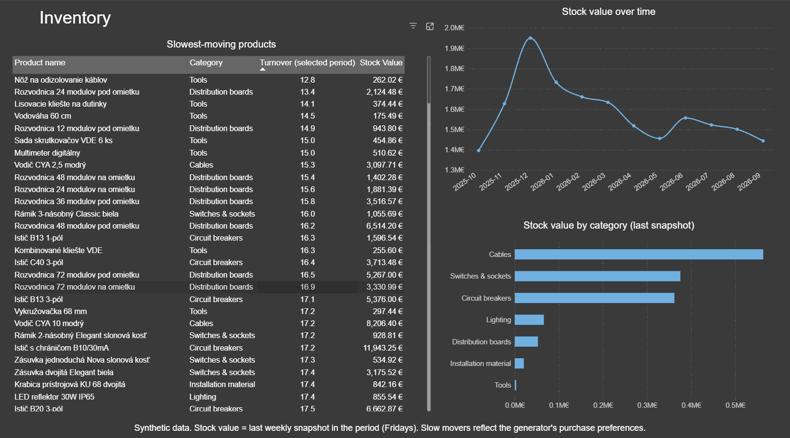
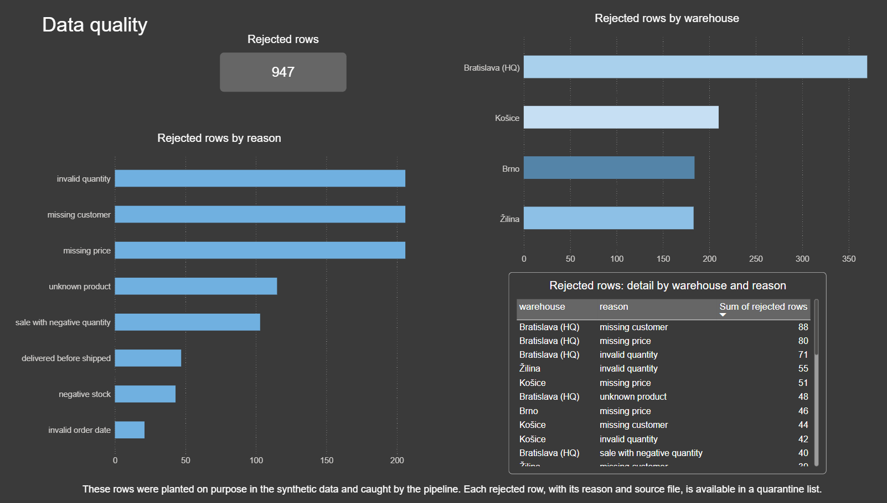
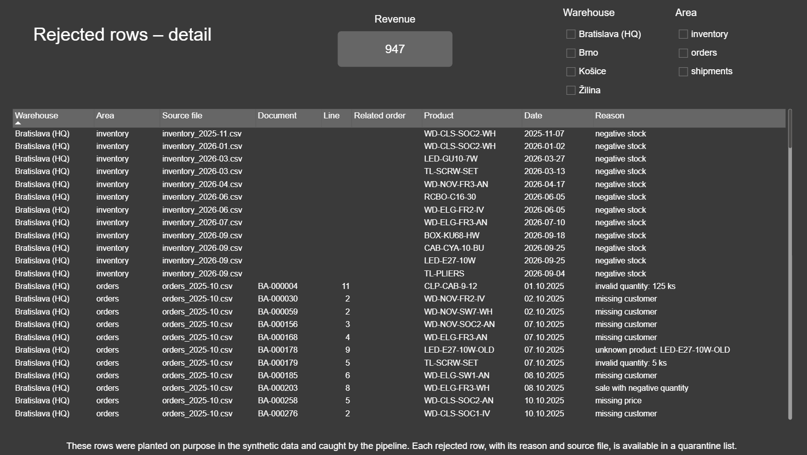

# Azure Distribution Data Pipeline


> **Portfolio project with synthetic data.** The company, warehouses, customers
> and orders are fictional and generated by the code in `data_generator/`.
> No real client or company data is used.

> **How it was built:** a hands-on learning project, built with an AI assistant (Claude).
> I made the design decisions, ran and checked every step, and fixed the problems listed in this README.

[](https://app.powerbi.com/view?r=eyJrIjoiYmIwOTY3MGQtMzZhMC00NDNlLWI3N2QtYzAwMWJhZmYzMWU3IiwidCI6ImU3NzQ1ODE4LTA3MDItNDk5Yy1iMWY1LTkzZmViOTkzOTQ4ZCJ9)
**← click to open the interactive dashboard (no login needed)**

> **At a glance**
> - 151 messy ERP files from 4 warehouses → one tested star schema
> - 15 types of planted data problems; every detectable one caught and explained
> - Azure Blob · Data Factory · Azure SQL · dbt · Power BI · GitHub Actions · Discord alerts
> - Secure by design: managed identities and Microsoft Entra login, no stored passwords
> - Cost-aware: a full load costs under €0.50, protected by a budget alert



## Business problem
*(Simulated scenario)* A mid-sized SK/CZ wholesaler of electrical installation
material runs 4 warehouses (Bratislava, Žilina, Košice, Brno). Each warehouse
ERP exports data differently: CSV and Excel files, column names in Slovak,
Czech and English, EUR and CZK, UTF-8 and Windows-1250, duplicates and typos.
One warehouse changed its export format in the middle of the year.
Management cannot answer simple questions like *"which warehouse delivers
late?"* or *"which products sit on the shelf?"*

## Solution
```
ERP exports (CSV / Excel)
   → Azure Blob Storage (landing zone, files kept unchanged)
   → Azure Data Factory (loads every file into staging tables, as text)
   → Azure SQL Database (staging schema)
   → dbt (cleaning, validation, star schema, 50 data tests)
   → Power BI dashboard (4 pages, published to web)
```
Alerts go to Discord when the Data Factory load, the dbt build or CI fails.

## What is built
- **Data generator** — one year of data for 4 warehouses in 4 export styles,
  with 15 types of planted data problems recorded in a manifest. Deterministic:
  every run produces byte-identical files. 49 tests.
- **Landing zone** — private Blob container `raw` with 151 files.
- **Staging load (Azure Data Factory)** — metadata-driven: one list describes
  every source (folder, file pattern, delimiter, encoding, target table).
  Lineage columns `_source_file` and `_loaded_at` on every row; retries for a
  sleeping serverless database; all rows reconciled against the files.
- **dbt** in three layers:
  - **staging** — one model per source: standard names, safe type conversion
    (bad values become NULL, raw text kept), codes translated
  - **intermediate** — 4 warehouses combined, 2,588 duplicate rows removed
    (including a re-exported month), SKU typos matched to the product list,
    CZK converted to EUR with **official ECB daily rates**, every row validated
    with a written reason; rejected rows go to a quarantine model
  - **marts** — star schema: `fact_orders`, `fact_shipments`, `fact_inventory`,
    `dim_date`, `dim_product`, `dim_customer`, `dim_warehouse`, plus a data
    quality summary
- **Power BI** — 4 report pages (sales & margin, deliveries, inventory, data
  quality), 13 DAX measures incl. time intelligence (`CALCULATE`, `DATEADD`) and
  semi-additive stock value. Saved as a Power BI project (`powerbi/`, text files).
- **CI** — GitHub Actions runs ruff, pytest and `dbt parse` on every push.
- **Alerts** — Discord messages from Data Factory, dbt and CI, each tested by
  breaking something on purpose.

## Dashboard
| Deliveries | Inventory |
|---|---|
|  |  |

| Data quality | Data quality – detail |
|---|---|
|  |  |

## Data quality: every detectable problem caught
| Area | Problem | Rows rejected |
|---|---|---|
| orders | missing customer | 206 |
| orders | invalid quantity (e.g. `"125 ks"`) | 206 |
| orders | missing price | 206 |
| orders | unknown product (discontinued codes, `O` instead of `0`) | 115 |
| orders | sale with negative quantity | 103 |
| orders | invalid order date (e.g. `31.11.2025`) | 21 |
| shipments | delivered before shipped | 47 |
| inventory | negative stock | 43 |

Every rejected record is listed individually — warehouse, source file, document
and line (or product and date for stock), and the reason — in the dashboard page
*Data quality – detail* and in the model `dq_rejected_rows`, so it can be fixed
in the source ERP.

Fixed automatically instead of rejected: exact duplicates, a re-exported
month, SKU case and spacing typos, carrier name variants, the schema change,
three encodings. A missing inventory week is reported as a warning.

**Not detectable by rules:** 30 planted dates are wrong but real (e.g. a day
moved to 31 July). No format check can catch them; that needs a business rule.
This was found when dbt's numbers did not match the manifest (decision 019).

## Bugs found during the project
- A wildcard load in Data Factory **silently shifted columns** after a
  warehouse changed its export format, and even overwrote the lineage column.
  Found by reconciliation; fixed with per-file loading (decision 012).
- The test data generator created **real dates where impossible ones were
  intended**. Found because dbt's counts did not match the answer key (019).
- Status codes with **č/ř/ě never matched** because SQL text literals were not
  Unicode (`N'…'`). Caught by a `not_null` test (runbook).
- The CI workflow file was **invalid and silently stopped running** — found by
  testing the failure alert on purpose.

## Notes on the numbers
The data is synthetic, so **patterns in it come from the generator, not from
a real business.** Brno shows a higher margin because the simulated CZK price
list uses 25.0 CZK/EUR while the real ECB rate was 24.08–24.56 (decision 018).
The carrier and winter delivery delays were planted (decision 005); the
dashboard shows that they are detected. The project demonstrates correct and
traceable numbers, not business insights.

## Security
- No passwords or keys anywhere: Data Factory uses its managed identity;
  people and dbt log in with Microsoft Entra ID.
- Least privilege: Data Factory reads the landing zone and writes only to
  `staging`; the Power BI account can only read the star schema.
- The Discord webhook is a secret: Key Vault for Data Factory, `.env` locally,
  GitHub Secrets for CI — never in Git.
- Storage has no anonymous access; the database firewall allows only Azure
  services and listed IP addresses. `dim_customer` leaves out street and e-mail.

## Costs
- One resource group with a €1 monthly budget alert.
- Azure SQL uses the free offer with auto-pause (cannot create charges).
- A full Data Factory run costs about €0.40–0.50 (optimized from ~€2 by loading
  per file only where needed, decision 014). The weekly schedule is set up and
  tested, but **stopped**, because the synthetic data does not change.
- Power BI "Publish to web" from My workspace is free.

## How to run
Requirements: Python 3.12, Git, Azure CLI, ODBC Driver 18 for SQL Server.

```powershell
git clone https://github.com/jurajpijakdata/azure-distribution-pipeline.git
